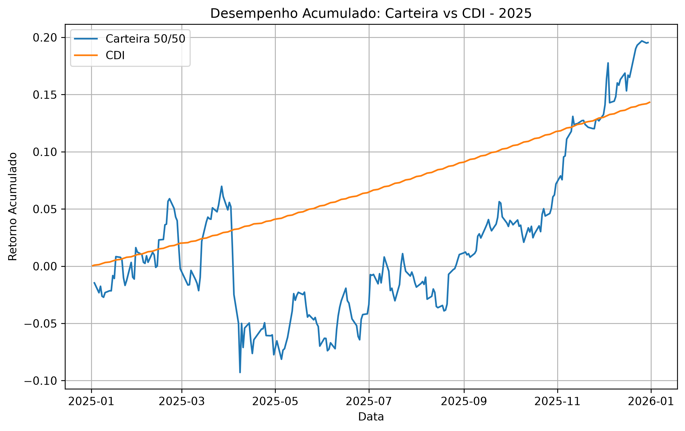
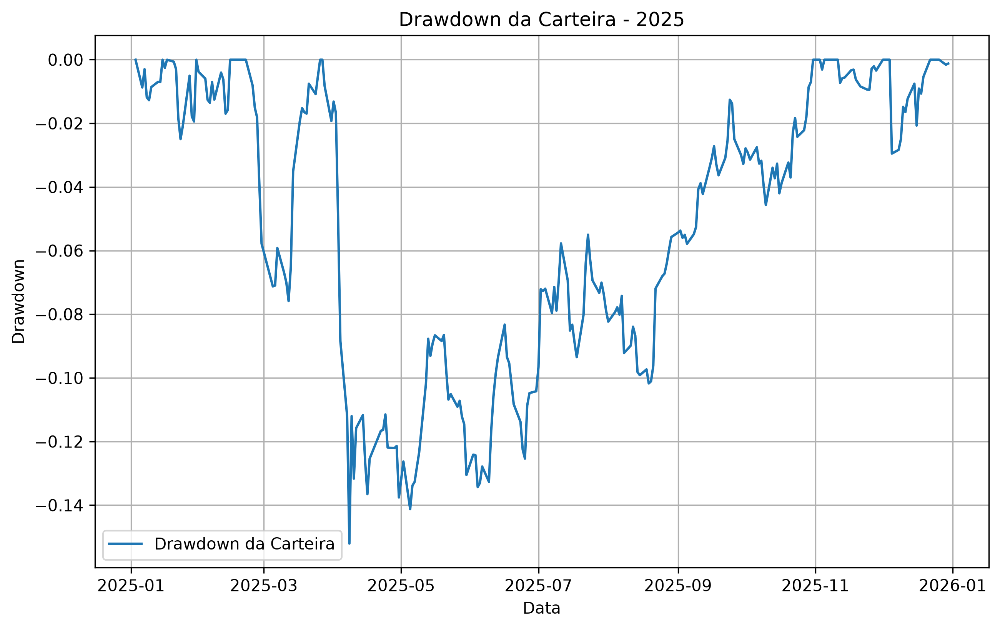

# Análise de Carteira de Investimentos com Python

Projeto desenvolvido em Python com o objetivo de aplicar conceitos básicos de análise de investimentos e praticar programação aplicada ao mercado financeiro.

A análise utiliza dados históricos de PETR4 e VALE3 para construir uma carteira com pesos iguais entre os dois ativos. O desempenho da carteira é analisado por meio de métricas de retorno e risco e comparado com referências do mercado brasileiro.

## Objetivos do Projeto

- Coletar dados históricos de ativos financeiros;
- Calcular retornos diários e acumulados;
- Calcular retorno médio anualizado;
- Calcular volatilidade anualizada;
- Calcular Sharpe Ratio;
- Analisar a correlação entre os ativos;
- Calcular drawdown e drawdown máximo;
- Comparar o desempenho dos ativos com o BOVA11;
- Construir uma carteira com 50% de PETR4 e 50% de VALE3;
- Comparar o desempenho acumulado da carteira com o CDI;
- Gerar uma tabela resumo das principais métricas;
- Criar visualizações do desempenho e do drawdown da carteira.

## Ativos Analisados

- PETR4.SA — Petrobras PN
- VALE3.SA — Vale ON
- BOVA11.SA — ETF utilizado como benchmark de mercado

A carteira analisada possui a seguinte composição:

- 50% PETR4
- 50% VALE3

O CDI é utilizado como referência para comparação do desempenho acumulado da carteira.

## Métricas Calculadas

O projeto calcula as seguintes métricas:

- Retorno médio;
- Retorno médio anualizado;
- Retorno acumulado;
- Volatilidade;
- Volatilidade anualizada;
- Sharpe Ratio;
- Correlação;
- Drawdown;
- Drawdown máximo;
- Excesso de retorno em relação ao BOVA11.

## Visualizações

### Carteira vs CDI

Compara a evolução do retorno acumulado da carteira 50/50 com o CDI durante o período analisado.



### Drawdown da Carteira

Mostra as quedas da carteira em relação aos seus máximos históricos durante o período.



## Tecnologias Utilizadas

- Python
- Pandas
- NumPy
- yfinance
- python-bcb
- Matplotlib

## Fontes de Dados

Os preços históricos dos ativos são obtidos por meio da biblioteca `yfinance`.

Os dados do CDI são obtidos através do Sistema Gerenciador de Séries Temporais do Banco Central do Brasil utilizando a biblioteca `python-bcb`.

## Como Executar

Instale as dependências:

```bash
pip install -r requirements.txt
```

Depois execute:

```bash
python main.py
```

O programa realiza os cálculos, exibe a tabela resumo e gera automaticamente:

- `tabela_resumo.csv`
- `carteira_vs_cdi.png`
- `drawdown_carteira.png`

## Estrutura do Projeto

```text
analise-carteira-python/
├── main.py
├── README.md
├── requirements.txt
├── .gitignore
├── tabela_resumo.csv
├── carteira_vs_cdi.png
└── drawdown_carteira.png
```

Os três últimos arquivos são gerados após a execução do programa.

## Sobre o Projeto

Este projeto foi desenvolvido como parte do meu aprendizado inicial de Python aplicado a finanças. O objetivo principal foi consolidar conceitos básicos de programação, manipulação de dados e análise de risco e retorno por meio de uma aplicação prática.
